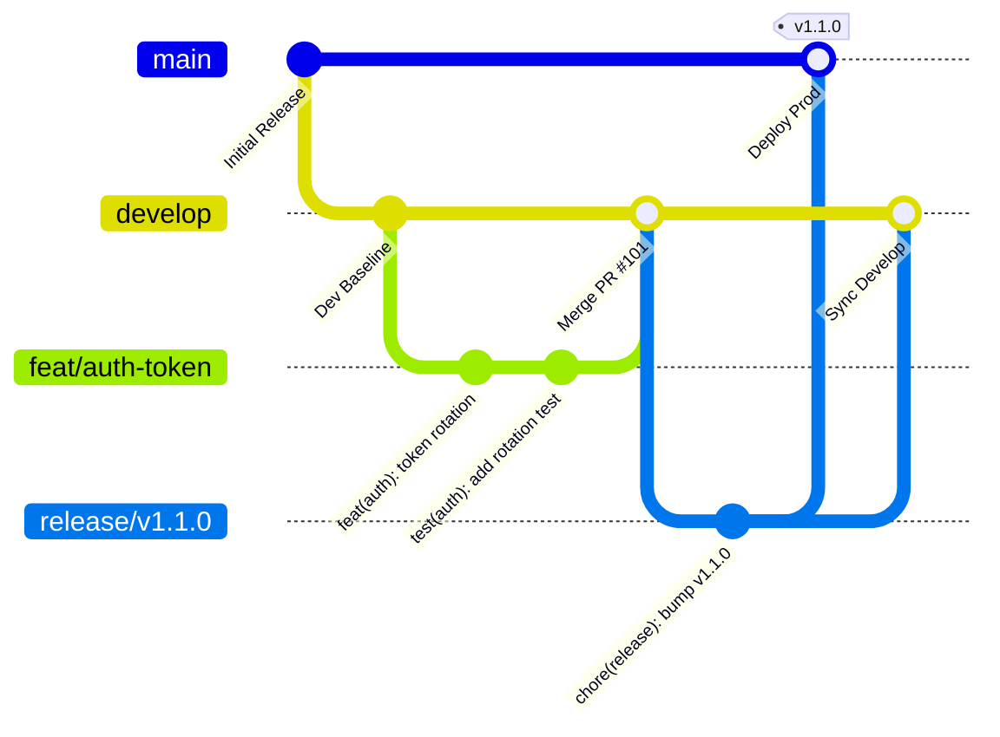

# Zenith Admin Portal - Git Flow & Engineering Architecture Guide

This document establishes the official engineering lifecycle, branching model, commit conventions, automated quality gates, and container orchestration standards for the Zenith Admin Portal.

---

## 1. Branching Model

We adhere to an adapted **Trunk-Based / Git Flow** hybrid optimized for web applications with continuous integration and automated staging deployments.



### 1.1 Branch Taxonomy

| Branch Type | Naming Convention | Base Branch | Merges Into | Purpose |
|:---|:---|:---|:---|:---|
| **Production** | `main` | - | - | Production-ready code only. Tagged with SemVer (`v1.0.0`). |
| **Integration**| `develop` | `main` | `main` | Active integration branch where completed features assemble. |
| **Feature** | `feat/<issue-id>-<slug>` | `develop` | `develop` | New functionality or UI enhancements. |
| **Bugfix** | `fix/<issue-id>-<slug>` | `develop` | `develop` | Non-critical bug repairs. |
| **Hotfix** | `hotfix/<slug>` | `main` | `main` & `develop` | Critical production patch bypassing normal sprints. |
| **Release** | `release/vX.Y.Z` | `develop` | `main` & `develop` | Pre-deployment staging hardening and version tagging. |

---

## 2. Commit Message Standard (Conventional Commits)

Commit messages MUST adhere strictly to the [Conventional Commits v1.0.0](https://www.conventionalcommits.org/) specification.

### 2.1 Format Structure
```
<type>(<optional-scope>): <subject>

[optional body describing the motivation or technical context]

[optional footer(s) referencing issue IDs, e.g., Closes #42]
```

### 2.2 Allowed Types

- `feat`: A new admin or API feature
- `fix`: A bug fix
- `docs`: Documentation updates only
- `style`: Formatting, white-space, semicolon fixes (no functional code changes)
- `refactor`: Architectural refactoring with unchanged behavior
- `perf`: Performance optimization
- `test`: Adding or correcting tests
- `build`: Build system or external package dependency adjustments
- `ci`: CI/CD workflows and automated scripts
- `chore`: Tooling, housekeeping, or repository maintenance
- `revert`: Reverting an earlier commit

### 2.3 Scopes
Common scopes in the Zenith Admin Portal:
`auth`, `properties`, `leads`, `inspections`, `documents`, `transactions`, `analytics`, `db`, `docker`, `ui`, `api`.

### 2.4 Examples
```bash
feat(properties): implement batch status updates for listings
fix(auth): prevent infinite loop on expired refresh token
chore(docker): configure production multi-stage standalone runner
docs(api): document agent assignment endpoint parameters
```

---

## 3. Automated Git Hooks (`.githooks/`)

The repository enforces quality gates before any code is committed or pushed:

| Hook | File | Action Executed |
|:---|:---|:---|
| **Pre-Commit** | `.githooks/pre-commit` | 1. Secret/key leak scanner (blocks `.env`, `.pem`, `id_rsa`)<br>2. ESLint checks (`npm run lint`)<br>3. Strict TypeScript type check (`npm run typecheck`) |
| **Commit-Msg** | `.githooks/commit-msg` | Validates commit subject against Conventional Commits regex. |
| **Pre-Push** | `.githooks/pre-push` | 1. Vitest test suite (`npm run test`)<br>2. Production build verification (`npm run build`) |

### Activating Hooks
Hooks are automatically configured during `npm install` via the `"prepare"` script:
```bash
make hooks-install
# Or manually:
git config core.hooksPath .githooks
chmod +x .githooks/*
```

---

## 4. Makefile Automation Reference

The `Makefile` is the single source of operational truth:

```bash
# Display help and target catalog
make help

# Local Development
make install         # Install dependencies & activate git hooks
make dev             # Launch Next.js dev server with Turbopack (http://localhost:3000)
make check           # Run lint + typecheck + test suite
make build           # Build optimized production standalone release

# Database
make db-up           # Spin up PostgreSQL 16 container
make db-migrate      # Apply Drizzle migrations
make db-seed         # Seed baseline admin credentials
make db-demo         # Seed rich properties and demo transactions
make db-reset        # Complete database wipe, migration, and re-seeding

# Docker Workflows
make docker-dev      # Launch development Docker stack with hot reload
make docker-dev-down # Stop development Docker stack
make docker-prod-up  # Build & run production standalone stack in background
make docker-prod-down# Stop production Docker stack
make docker-prod-logs# Stream production container logs
```

---

## 5. Docker Environments

### 5.1 Development Architecture (`docker-compose.dev.yml`)
- Base image: `node:22-alpine` (`Dockerfile.dev`)
- Live reload via source directory bind mount: `.:/app`
- Preserved container-native `node_modules` via anonymous volume
- Attached to local PostgreSQL 16 service on internal port `5432` (host `54329`)

### 5.2 Production Architecture (`docker-compose.prod.yml`)
- Multi-stage build (`Dockerfile`):
  1. `base`: Alpine Linux with `libc6-compat`
  2. `deps`: `npm ci` cache mount
  3. `builder`: `next build` with standalone tracing enabled (`output: 'standalone'`)
  4. `runner`: Unprivileged system user `nextjs:nodejs` (UID 1001) executing `node server.js`
- Image size: **< 160MB** (compared to > 1.2GB standard Node images)
- Health check: HTTP probe on `/api/health` every 30s
- Resource limits: CPU and Memory caps with JSON log rotation

---

## 6. Pull Request & Merging Protocol

1. **Self-Check Before PR**:
   ```bash
   make verify-pr
   ```
2. **Pull Request Checklist**:
   - [ ] Branch branched off the latest `develop`
   - [ ] Conventional Commit history
   - [ ] All CI checks passing (Lint, Types, Tests, Standalone Build)
   - [ ] No extraneous console logs or untyped `any`
   - [ ] Database schema changes include corresponding Drizzle migration scripts
3. **Merge Strategy**:
   - **Squash and Merge** for single feature branches into `develop`
   - **Rebase and Merge** or **Create a Merge Commit** for releases into `main`
